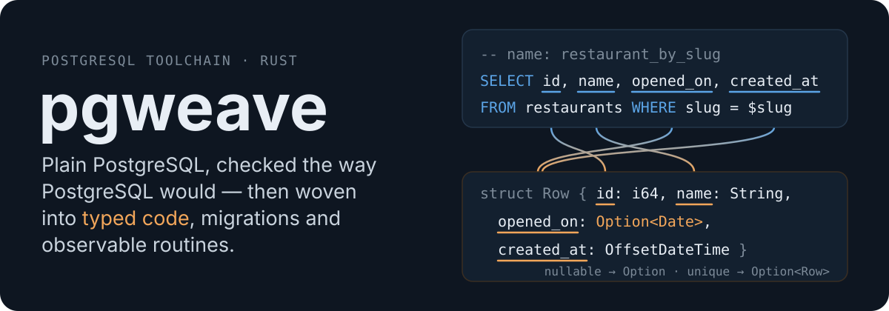
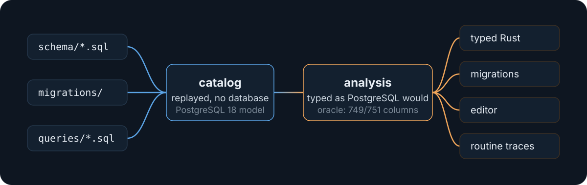

<p align="center">
  
</p>

<p align="center">
  <a href="#try-it">Try it</a> ·
  <a href="./site/src/content/docs/getting-started.md">Documentation</a> ·
  <a href="#status">Status</a>
</p>

You write PostgreSQL — queries in `.sql` files, a schema, migrations,
PL/pgSQL routines — and it stays raw: no ORM, no DSL. pgzest only
seasons it: it rebuilds the catalog from those files, without a
database, checks every statement the way PostgreSQL would, and turns the
result into typed Rust, verified migrations, editor feedback and
traceable routines.

```sql
-- queries/restaurants.sql
-- name: restaurant_by_slug
SELECT id, name, opened_on, created_at
FROM restaurants
WHERE slug = $slug;
```

```rust
// src/queries.rs
pgzest_macros::queries!("queries");

// slug is UNIQUE: at most one row. opened_on is nullable: Option.
let r: Option<RestaurantBySlugRow> =
    queries::restaurants::restaurant_by_slug(&client, RestaurantBySlugParams { slug: "le-bistrot" }).await?;
```

A mistake in the SQL fails the build, at its place in the `.sql` file:

```text
error: undescribed queries:
       …/examples/demo/queries/restaurants.sql:11:18: error[column-not-found]: column "opened_at" does not exist
 --> examples/demo/src/queries.rs:5:25
  |
5 | pgzest_macros::queries!("queries");
  |                         ^^^^^^^^^
```

## Checked against PostgreSQL itself

An oracle runs in CI against a real PostgreSQL 18 and compares what
PostgreSQL says with what pgzest says:

| What | Result |
|------|--------|
| Columns and parameters of 243 queries | **749/751** and **146/146** typed exactly as PostgreSQL prepares them |
| Function and operator overload resolutions | **19,032/19,032** identical |
| Two real projects' migrations (1,740 and 294 statements) | fully parsed; catalogs rebuilt identical to the real databases — DDL run through dynamic SQL aside, reported instead of guessed |
| Generated Rust against hand-written `tokio-postgres` | **145.0 vs 145.7 µs** per query |

What pgzest cannot establish, it says (`not-analyzed`,
`query-parameter-untyped`…). It never guesses a type or a nullability.

## What it does

**Typed queries in Rust.** Named queries in `.sql` files, `sql!` in the
code or `query!` inline become functions over `tokio-postgres`, with
parameter and row structs, generated enums, `Option` exactly where a value
can be null, and a return type that follows the number of rows.
`COPY … FROM STDIN` included. → [guide](./site/src/content/docs/guides/rust.md)

**Analysis as PostgreSQL would.** Overloads, implicit casts, nullability
through joins, `DEFAULT` and generated columns, PL/pgSQL bodies, and each
trigger function checked once per table that fires it. Errors use
PostgreSQL's words, at the faulty expression.
→ [guide](./site/src/content/docs/guides/checking.md)

**Fragments and macros.** A column list or an expression written once and
inserted with `@name` — in the schema, the queries and the Rust strings —
so an index and the query that must use it cannot drift apart.
`@function`, `@procedure` and `@trigger` without the boilerplate, expanded
to plain SQL. → [guide](./site/src/content/docs/guides/fragments-and-macros.md)

**Declarative schema, generated migrations.** Edit `schema/`, then
`pgzest migrate create` writes the migration and replays it to verify
it reaches the schema; what may lose data or fail on a populated table is
listed at its top. Prisma and Diesel layouts are read as they are.
`pgzest db check` finds what was changed by hand in a production
database. → [guide](./site/src/content/docs/guides/migrations.md)

**Observable routines.** Isolated temp tables, snapshots and run logs in
PL/pgSQL routines; the triggers a statement fired, as OpenTelemetry spans
under your request's span; `pgzest.max_depth` to stop an endless trigger
cascade by name. About a microsecond per run when the request is not
traced. → [guide](./site/src/content/docs/guides/observability.md)

**In the editor.** VS Code: errors as you type, hover with types and query
descriptors, completion, macro expansion — in SQL files and inside Rust
strings. → [guide](./site/src/content/docs/guides/editor.md)

## How it works

<p align="center">
  
</p>

The catalog of PostgreSQL 18 and of extensions such as `citext`,
`pg_trgm` or PostGIS is generated from a real server and versioned in the
repository; your files are replayed on it in order, each statement
checked against the state at that point. Every query gets a descriptor —
parameters, columns, types, nullability, number of rows — that the Rust
generation, the migrations and the editor all read.
→ [how it works](./site/src/content/docs/how-it-works.md)

## Try it

Prerequisites: [Rust](https://rustup.rs), Node.js 24 or later (the VS Code
extension), Docker (PostgreSQL 18).

```sh
make bootstrap   # Rust and npm dependencies
make demo        # VS Code on examples/demo, with the pgzest extension loaded
make demo-run    # the demo's Rust program against PostgreSQL 18 (Docker)
```

[`examples/demo`](./examples/demo) is a small ordering application written
like a real project — declarative schema, generated migrations, named
queries, Rust code, a traced trigger — and its README is a guided tour.
To start a project of your own:
[getting started](./site/src/content/docs/getting-started.md).

## Status

pgzest works on real projects' schemas and is tested against PostgreSQL
18 in CI, but it is not released yet:

- not published to crates.io or npm, nor the extension to the VS Code
  marketplace: build from this repository;
- PostgreSQL 18 only;
- Rust only for now — TypeScript is the next phase;
- known gaps are listed, not hidden: a `ROWS FROM (…)` the parser does not
  read yet, DDL in a file classified as queries not applied
  ([`PLAN.md`](./PLAN.md), the steering document, has the phases and the
  open items).

## Building and contributing

```sh
make ci          # what CI checks: build, tests, clippy, fmt, typecheck
make oracle      # the analysis against PostgreSQL 18 (Docker)
make site-dev    # the documentation site, locally (Node.js 24 or later)
```

The documentation lives in [`site/`](./site) (Astro Starlight); its CLI
and diagnostics references are generated from the code
(`cargo xtask docs`). Code, comments and documentation are in English.

## License

[MIT](./LICENSE)
